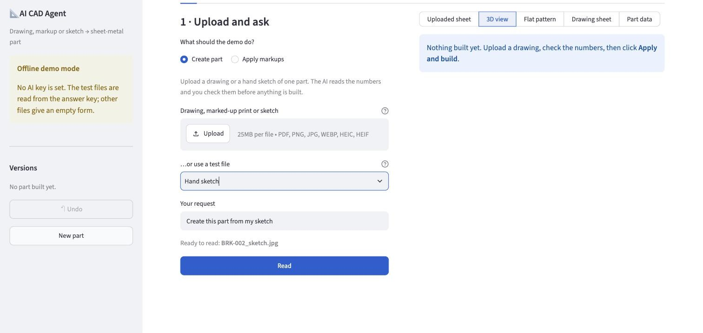
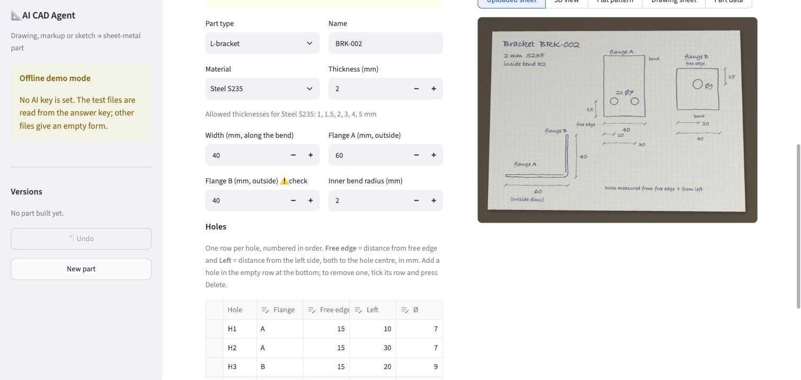
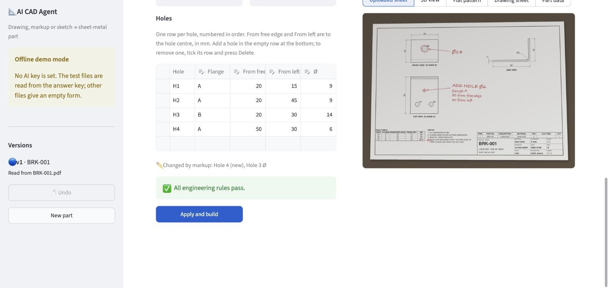
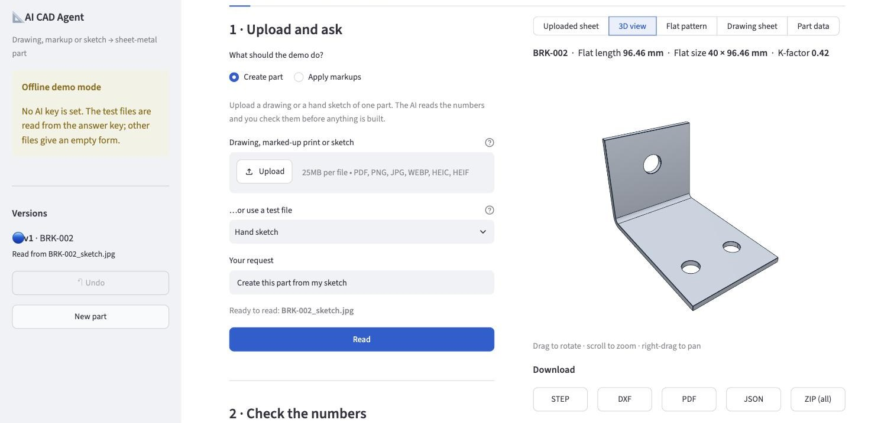
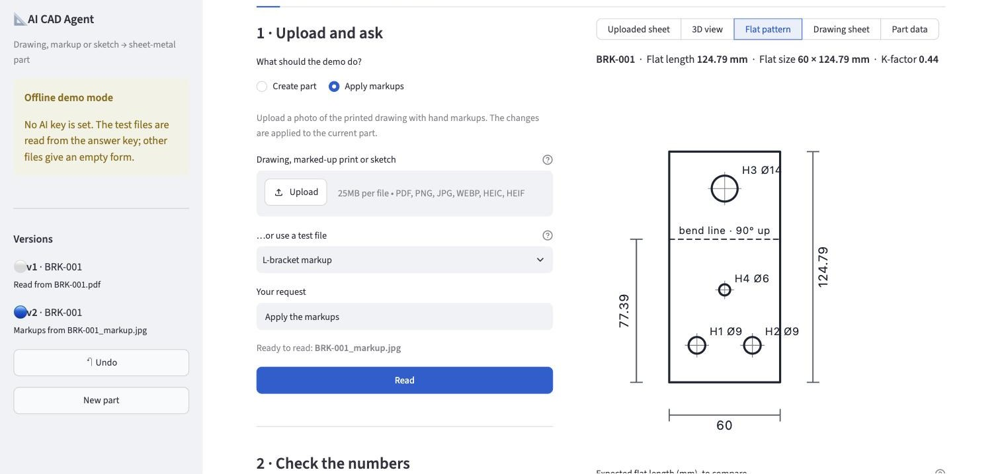
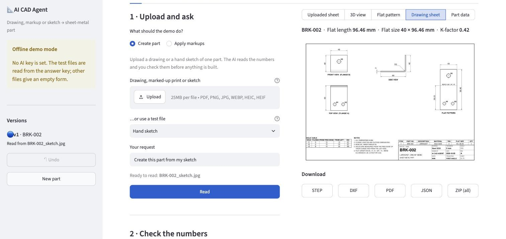
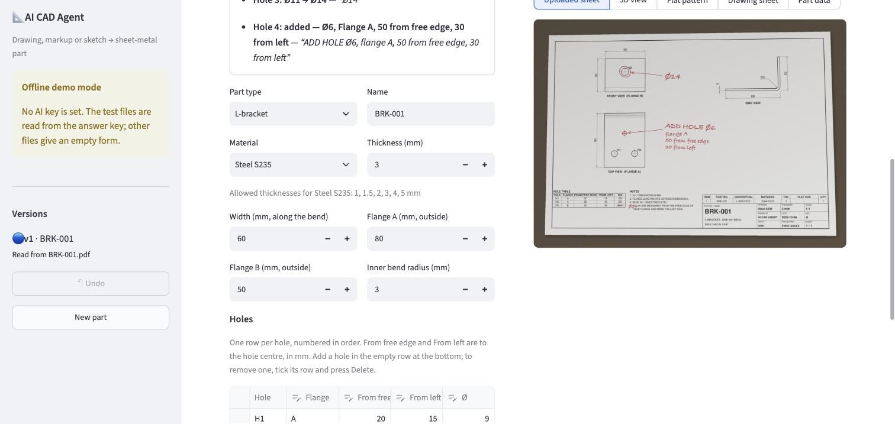

# How to use the AI CAD Agent

This guide is for the domain expert. It walks through the three demo scenarios, explains
what each part of the screen means, and lists what to check before sign-off. No software
knowledge is needed.

## The idea in one minute

You give the demo a picture of **one sheet-metal part**: a drawing, a printed drawing with
hand markups, or a hand sketch. Then:

1. **The AI reads the numbers** from the picture (thickness, lengths, holes).
2. **You check the numbers** in a form and correct anything that is wrong.
3. **The software builds the part** from those numbers: 3D model, flat pattern and a
   drawing sheet.

The AI never draws the part itself. It only fills in the form. Nothing is built until you
click **Apply and build**, so a misread value cannot slip through unnoticed.

Supported parts: a **flat plate** and an **L-bracket** (one 90° bend), with round holes.

## Before you start

Look at the box at the top of the left-hand sidebar:

- **AI reading is on** — pictures are read by the AI. You can upload your own files.
- **Offline demo mode** — no AI key is set. Only the five built-in test files work; they
  are filled in from the answer key. Any other file gives an empty form to fill in by
  hand. Ask the developer to add the key if you see this and want to test your own files.

## Scenario 1 — Drawing to part

**Step 1. Choose the file.** Keep **Create part** selected. Click **Upload** and pick your
drawing (PDF, PNG, JPEG or a phone photo), or choose one from **…or use a test file**.

**Step 2. Type a request and click Read.** For example "Create this part". The request is
passed to the AI as context; the default is fine.

**Step 3. Check the numbers.** The form appears under *2 · Check the numbers*, and your
sheet is shown on the right so you can compare them side by side. The sheet stays in view
while you scroll down the form.

What the marks mean:

| Mark | Meaning | What to do |
|---|---|---|
| ⚠️ **check** next to a label | The AI was not sure about this value, or it was not on the sheet and a default was used | Compare with the sheet and correct it if needed |
| ✏️ **changed** next to a label | A markup changed this value (scenario 2) | Confirm the new value is right |
| Yellow box under the form | The part breaks an engineering rule, e.g. "Hole 2 is too close to the bend" | Fix the value, or use **Build anyway** |
| Red box under the form | The part cannot exist as entered, e.g. a hole that runs off the edge, or a missing value | Fix the value; it cannot be overridden |
| Green box | All engineering rules pass | Go on to step 4 |

A mark disappears as soon as you edit that value. The rule check updates every time you
change something, so you see the effect straight away.

**The holes table.** One row per hole, numbered H1, H2, … in order.

- **Flange** (L-bracket only): A or B.
- **Free edge**: distance from the free edge of that flange to the hole centre. For a
  plate this column is **Bottom**: distance from the bottom edge.
- **Left**: distance from the left side to the hole centre.
- **Ø**: hole diameter.
- To **add** a hole, type in the empty row at the bottom of the table.
- To **remove** a hole, tick the box at the left of its row and press the Delete key.

**Step 4. Click Apply and build.** After a few seconds the view switches to the 3D part.

**Step 5. Review the outputs.** Use the buttons above the picture:

- **Uploaded sheet** — the picture you uploaded.
- **3D view** — drag to rotate, scroll to zoom.
- **Flat pattern** — outline, holes, bend line and main dimensions. Type your own flat
  length into **Expected flat length** to see whether it matches within the tolerance.
- **Drawing sheet** — front, top and side views, flat pattern, hole table, title block and
  parts list.
- **Part data** — the numbers behind the part.

**Step 6. Download.** STEP (3D model, opens in Inventor, SolidWorks or Fusion), DXF (flat
pattern for laser cutting), PDF (drawing sheet), JSON (part data), or everything as one ZIP.

## Scenario 2 — Markup to change

Do scenario 1 first: a markup changes the part that is currently loaded.

1. Select **Apply markups**.
2. Upload a **photo of the printed drawing with your hand markups** (or pick a markup test
   file). Tips for the photo: flat sheet, good light, whole sheet in the frame, markups in
   a colour that stands out, such as red pen.
3. Click **Read**. The demo lists each change as **was → now**, with the handwriting it
   came from:

4. The form below already contains the changed values. Check them against your markups and
   correct anything that was misread.
5. Click **Apply and build**. A new version of the part is created.

How to write markups the AI can follow: refer to holes by their number from the hole table
("H3 Ø14"), write the new value rather than the difference ("20 from bottom", not "+5"),
and for a new hole give its diameter, flange and both distances.

## Scenario 3 — Sketch to part

Exactly like scenario 1, but upload a photo of a hand sketch with written dimensions.
Expect more ⚠️ **check** marks than with a clean drawing, and check every value. A sketch
is easiest to read when it states the thickness and material, labels the flanges A and B,
says whether dimensions are outside dimensions, and shows where the free edge is.

## Versions, Undo and New part

Every **Apply and build** creates a new version, listed in the sidebar with what produced
it (for example "Read from BRK-001.pdf" or "Markups from BRK-001_markup.jpg").

- **Undo** steps back to the previous version of the part. The undone version is discarded.
- **New part** clears everything so you can start with another drawing.
- You can also change any value in the form by hand and click **Apply and build** to
  rebuild the part, without uploading anything.

## Dimension conventions

The AI and the software both assume these. Drawings that follow a different convention
will be read wrongly.

- All dimensions are in mm.
- Flange lengths are **outside** dimensions. The L-bracket bend is 90°.
- **Width** is the size along the bend line. For a plate, **Length** is the horizontal
  size in the front view.
- L-bracket holes are measured from the **free edge** of their flange and from the
  **left side**.
- Plate holes are measured from the **bottom-left corner**.
- Hole sizes are diameters (Ø).
- If the drawing shows no bend radius, the one from the rules table is used.
- Flat length: `L = A + B − 2(r + t) + (π/2)(r + k·t)`, with A and B the outside flange
  lengths, r the inner bend radius, t the thickness and k the K-factor.

## If something goes wrong

| What you see | What it means | What to do |
|---|---|---|
| "Markups change an existing part. Create the part from its drawing first." | You chose Apply markups with no part loaded | Run scenario 1 first |
| "A markup refers to Hole 5, but the current part has 3 holes." | The markup photo belongs to a different part | Load the right part, or use New part |
| "This file could not be opened." | The file is not a PDF or an image | Save it as PDF, PNG or JPEG |
| "Thickness 7 mm is not allowed for Steel S235." | The value is not in the rules table | Correct it, or have the rules table extended |
| An empty form after Read | Offline demo mode with a file that is not a test file | Fill in the values by hand, or ask for the AI key |
| "The AI service is busy" or "Could not reach the AI service" | A temporary problem on the AI side | Wait a moment and click Read again |
| "Problem in rules.yaml: …" | The rules file has a typing mistake | The message says which value to fix |

## What we need you to check

These are the acceptance points from the requirements document.

1. **Dimension conventions** — are the conventions above the ones you use? In particular,
   which side is "left" for holes on Flange B.
2. **Engineering rules** — the materials, thicknesses, bend radii, K-factors and limits
   currently in the demo are placeholders. Please supply your values.
3. **Reading accuracy** — for each of your test files, is every value read correctly or
   marked ⚠️ check?
4. **Flat lengths** — do they match your expected values within your tolerance? Use the
   **Expected flat length** box in the Flat pattern view.
5. **Drawing sheet and DXF** — are they correct and usable for review and for cutting?
6. **STEP file** — does it open in Inventor with the correct geometry?
